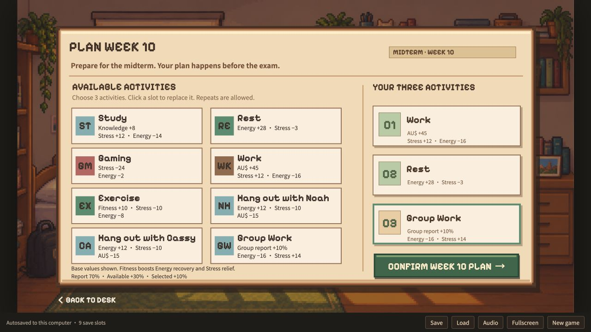

# Survive USYD

A pixel-art university life simulator created for the COMP9001 Python Project Challenge. Plan your weeks, manage your energy, stress and money, deal with a disappearing group member, and try to survive a semester at the University of Sydney. Your choices shape your academic results, friendships, optional romance and endings.



## Run the game

**Requirements:** Python 3.9 or newer and a modern web browser. The Python version uses only the standard library; no `pip install` step is needed. All game images, fonts and audio are included.

1. Download this repository using **Code → Download ZIP**, then extract it.
2. Open a terminal in the extracted project folder.
3. Start the game:

   **macOS / Linux**
   ```sh
   python3 backend/server.py --open-browser
   ```

   **Windows**
   ```powershell
   py backend/server.py --open-browser
   ```

4. The game opens at **http://127.0.0.1:8765**. Keep the terminal open while playing. Press **Ctrl+C** in the terminal to stop the server.

On macOS, `Start Game.command` also provides a double-click launcher. If port 8765 is already in use, add `--port 8766` to the command.

The intended project entry point is `backend/server.py`. Opening `html-game/index.html` directly runs an optional standalone JavaScript version with separate browser-local saves. A static web server or GitHub Pages does not run the Python backend.

## How to play

- Create a character and enter a name, then explore O-Week.
- Choose three activities each week. Activity cards show their effects before you commit.
- Balance Knowledge, Energy, Stress, Fitness and Money while progressing through classes, exams and group work.
- Save or load from nine manual slots. **Continue game** on the title screen opens the load menu.
- Use **Audio** to adjust or mute background music and button sounds.
- Finish the semester to discover your academic ending, with an additional romance ending if that relationship succeeds.

## Saves

The Python server creates `backend/data/survive.sqlite3` automatically. This database is local to your computer and is not included in the repository. Automatic progress and nine manual save slots are associated with your browser profile. Starting a new game keeps your manual saves.

Use **Export saves** to make a backup before changing browsers or clearing browser data. **Import saves** fills empty slots without replacing existing saves. The game has no online accounts or cloud synchronization.

## Python implementation

The Python backend executes the game rules, including choices, weekly plans, random wheel rewards, resource changes, exam scoring, branching scenes and ending conditions. The browser presents the scenes and sends the player's available actions to Python.

The project demonstrates:

- **Functions and classes:** separate rule execution, persistence and HTTP request handling.
- **File I/O:** loading the authored game data and importing/exporting save backups.
- **Error handling and validation:** rejecting invalid actions, malformed saves and stale requests without corrupting progress.
- **SQLite transactions:** persistent save slots, automatic progress and protection against duplicate requests.
- **Collections and conditional logic:** interpreting story nodes, activity effects and branching outcomes.

## Project layout

```text
backend/
  server.py                 Python entry point and local HTTP server
  game_backend/engine.py    Story, planning and game-rule execution
  game_backend/store.py     SQLite persistence and request transactions
  tests/                    Python tests and compressed route fixtures
html-game/
  index.html                Browser interface
  app.js                    Scene rendering and interaction
  backend-client.js         Connection to the Python server
  data/game.json            Shared authored scenes and rules
  engine.js                 Optional standalone browser rule engine
  assets/                   Bundled images, fonts and audio
  tools/                    Tests and development utilities
docs/gameplay.png           Gameplay screenshot
Start Game.command          macOS launcher
```

## Tests

Run the Python suite from the project root:

```sh
python3 -m unittest discover -s backend/tests -v
```

On Windows, replace `python3` with `py`. Tests use temporary databases and do not modify your saves. They cover full story routes, resource boundaries, random rewards, save/load persistence and HTTP validation.

Additional browser-engine checks are available for developers with Node.js 18 or newer:

```sh
node html-game/tools/test-game.js
node html-game/tools/test-boundaries.js
node html-game/tools/test-saves.js
node html-game/tools/test-wheel.js
node html-game/tools/test-display-format.js
node html-game/tools/test-audio.js
```

Node.js is not required to play the Python version.

## Notes and credits

Survive USYD is a fictional student project, not an official University of Sydney product. Characters, events and game grading rules are designed for the game.

The interface and story were developed from the project's Figma designs. Backgrounds, portraits and ending illustrations are bundled in `html-game/assets/`. The original background loop and click sound are documented in `html-game/assets/audio/README.txt` and can be regenerated with the included Python audio utility. The soundtrack does not use Stardew Valley recordings or melodies.

Bundled fonts are [Pixelify Sans](https://github.com/google/fonts/tree/main/ofl/pixelifysans) and [Noto Sans SC](https://github.com/google/fonts/tree/main/ofl/notosanssc). Their SIL Open Font License notices are included in `html-game/assets/licenses/`.

This repository provides the project for download and local play. Uploading it to GitHub does not publish an online game server.
